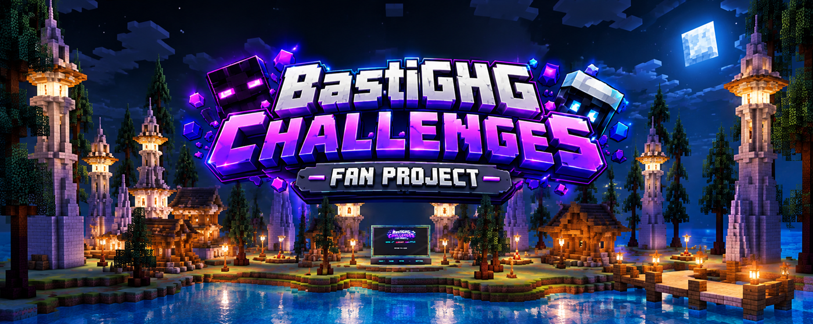
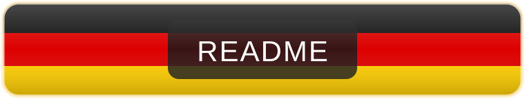
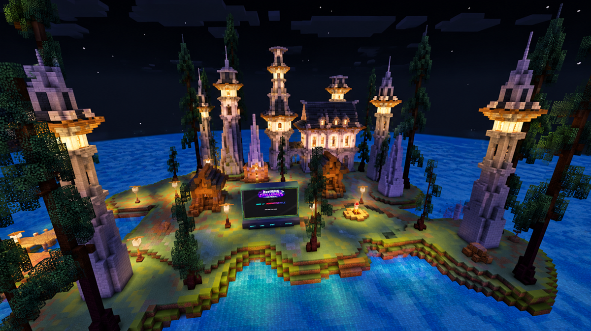
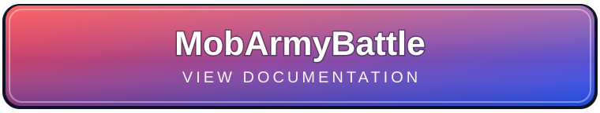
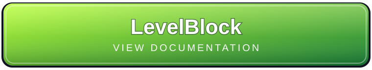

  

 

&nbsp;&nbsp;&nbsp;&nbsp;

&nbsp;&nbsp;&nbsp;&nbsp;

  

  
  &nbsp;&nbsp;&nbsp;
  

### One Plugin. Multiple Challenges. One Central Lobby.

**A Minecraft Paper plugin combining multiple independent challenge games into one unified system.**

*All your favorite challenges in one place!*

> **Disclaimer:** BastiGHG Challenges is an independent, unofficial fan project inspired by Minecraft challenges played by BastiGHG. It is not affiliated with, endorsed by, or officially connected to BastiGHG.

---

<h2 align="center"></h2>

**BastiGHG Challenges – Fan Project** brings multiple Minecraft challenge game modes together in a single Paper plugin.

Instead of installing and managing separate plugins for every challenge, players can access all integrated games through one shared lobby.

Each game maintains its own worlds, player data, settings and progress while being managed by a centralized system.

The project is continuously developed with new challenge games, improvements and additional features planned for future releases.

**The goal: One central platform for an expanding collection of Minecraft challenges.**

---

<h2 align="center"></h2>

  

The central lobby is the heart of BastiGHG Challenges.

From here, players can select, load, configure and manage the available challenge games.

### Lobby Features

- Central game selection and management
- Dynamic loading and unloading of games
- Interactive displays and buttons
- Game status and loading information
- Centralized game reset and voting systems
- Shared world settings and management
- German and English language support
- Custom logos, icons and interface graphics

Every challenge runs in its own environment, keeping different game modes separated while allowing players to switch between them.

---

<h2 align="center"></h2>

  Explore the available challenge games. 
  Click on a game to view its dedicated documentation.

  
  &nbsp;&nbsp;
  
  &nbsp;&nbsp;
  

---

<h3 align="center"></h3>

BastiGHG Challenges is designed to grow.

Additional game modes, new mechanics and further improvements are planned for upcoming versions.

The community can help shape future development by suggesting new challenges and sharing feedback on Discord.

**[Join the Community](https://discord.gg/t2c98sWr7G)**

---

<h2 align="center"></h2>

| Feature | Description |
|---|---|
| 🏠 Central Lobby | One shared hub for all challenge games |
| 🎮 Multiple Games | Different challenges integrated into one plugin |
| 🌍 Independent Worlds | Separate worlds for individual game modes |
| 👤 Player Data | Individual player data and inventories |
| 🔄 Dynamic Game Management | Load and unload games as needed |
| 💾 Save & Resume | Save and restore supported game progress |
| 🛠️ World Settings | Centralized management of game world options |
| 🗳️ Voting System | Multiplayer voting for supported actions |
| ♻️ Reset Management | Central management of game and world resets |
| 🌐 Languages | German and English support |
| 🎨 Resource Pack | Custom lobby graphics, logos and icons |
| 👥 Multiplayer | Challenge gameplay with friends |

---

<h2 align="center"></h2>

### Requirements

| Component | Required Version |
|---|---|
| Minecraft | Java Edition |
| Server Software | Paper 26.3 |
| Java | Java 25 |

**Important:** The current release requires Paper 26.3. Paper 26.2 and earlier versions are not supported.

### Getting Started

1. Download the latest BastiGHG Challenges `.jar` file.
2. Place the file inside your Paper server's `plugins` folder.
3. Start or restart your Minecraft server.
4. Join the server and enter the central lobby.
5. Select, load and start your preferred challenge game.

### Main Commands

| Command | Description |
|---|---|
| `/lobby` | Return to the central lobby |
| `/language` | Open the language selection |
| `/gamesettings` | Open the selected game's settings |
| `/mobarmy` | MobArmyBattle commands |
| `/levelborder` | LevelBorder commands |
| `/levelblock` | LevelBlock commands |

Each game also provides its own information commands and additional functionality.

---

<h2 align="center"></h2>

BastiGHG Challenges includes an optional resource pack for the custom visual elements used throughout the plugin.

It provides:

- Custom lobby logos
- Game icons
- Interface symbols
- Custom display graphics

The resource pack is automatically offered when joining the server.

Without the resource pack, some custom visual elements may not display correctly.

---

<h2 align="center"></h2>

**Current Project Version:** `v1.0.1 Stable`

The first stable version of BastiGHG Challenges was released as `v1.0.0`.

Development continues with bug fixes, compatibility updates, optimizations and additional game modes.

**[📜 View Changelog](CHANGELOG.md)**

**[📦 View GitHub Releases](https://github.com/DrRuni/BastiGHG-Challenges/releases)**

---

<h2 align="center"></h2>

Feedback, feature suggestions and bug reports are always welcome.

Join the Discord community to:

- Report bugs and technical issues
- Suggest new challenge games
- Share ideas and feedback
- Follow development announcements
- Participate in community discussions

**[💬 Join our Discord Server](https://discord.gg/t2c98sWr7G)**

---

<h2 align="center"></h2>

BastiGHG Challenges is an independently managed fan project developed with the assistance of AI tools.

AI-assisted development supports Java programming, documentation and selected graphical assets.

Gameplay concepts, development decisions, integration, testing and project maintenance are directed and managed by the project creator.

---

<h2 align="center"></h2>

Copyright © 2026 DrRuni. All rights reserved.

BastiGHG Challenges is **source-available, not open source**.

The source code is publicly available for viewing and inspection. General reuse, modification or redistribution is not permitted without prior written permission.

The compiled plugin may be downloaded and used on compatible Minecraft servers through official distribution channels.

**[View Copyright & Usage Terms](COPYRIGHT.md)**

---

**Made with ❤️ by DrRuni**

*BastiGHG Challenges – Fan Project*

**An independent community fan project. Not affiliated with BastiGHG.**

[GitHub](https://github.com/DrRuni/BastiGHG-Challenges) · [Releases](https://github.com/DrRuni/BastiGHG-Challenges/releases) · [Discord](https://discord.gg/t2c98sWr7G)

