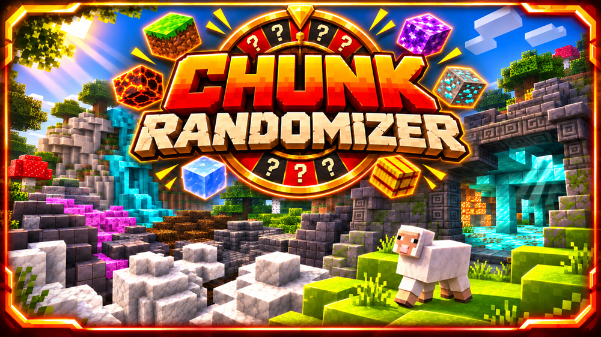

  

  

  Am 11. Januar 2026 spielte BastiGHG eine Minecraft-Challenge,
  bei der jeder Chunk zufällige Blöcke und Monster miteinander kombiniert.

  Mir hat diese besondere Challenge so gut gefallen, dass ich sie
  unbedingt in mein eigenes Fanprojekt aufnehmen wollte.

  So entstand das vierte Challenge-Game für
  <strong>BastiGHG Challenges – Fanprojekt</strong>.

  <a href="https://www.youtube.com/watch?v=iaAHQPM1AOk">
    Bastis ursprüngliche Challenge auf YouTube ansehen
  </a>

  

  
  &nbsp;&nbsp;&nbsp;
  -de
    
  </a>

ChunkRandomizer
ChunkRandomizer ist eine Minecraft-Challenge, die in BastiGHG Challenges – Fanprojekt integriert ist.

Jeder neue Chunk hält eine Überraschung bereit.

Sobald Spieler einen neuen Chunk betreten, werden dessen vorhandene Blöcke in einen zufällig ausgewählten Blocktyp umgewandelt.

Gleichzeitig erscheint ein Challenge-Mob, während die WorldBorder verhindert, dass die Spieler den aktuellen Chunk verlassen.

Besiege den Mob, um die Weltgrenze freizuschalten und weiterzuerkunden!

Jeder Chunk bietet neue Ressourcen, unerwartete Situationen und Herausforderungen.
Dieses Game ist Teil eines inoffiziellen Fanprojekts, das von BastiGHG inspiriert wurde. Es besteht keine offizielle Verbindung zu BastiGHG.

Funktionen
- Zufällige Blockumwandlung in neu erkundeten Chunks
- Ein zufällig ausgewählter Blocktyp pro Chunk
- Ursprüngliche Gelände- und Höhlenstrukturen bleiben erhalten
- Grundgestein (Bedrock) bleibt unverändert
- Chunkbasiertes WorldBorder-System
- Spawn von Challenge-Mobs
- Besiege den Mob, um die WorldBorder freizuschalten
- Multiplayer-Unterstützung
- Weltverwaltung für Oberwelt, Nether und End
- Dauerhafte Speicherung des Spielfortschritts
- Erfassung abgeschlossener Chunks
- Speicherung von Spielstatus und Challenge-Timer
- Automatische Speicherung der Spieldaten
- Getrennte Welt- und Spielerdaten
- Integration in die zentrale Challenge-Lobby
- Zentrale Welteinstellungen
- Reset-Verwaltung
  Befehle
  Hauptbefehle
- /chunkrandomizer
- /chunkrandomizer info
- /chunkrandomizer start
- /chunkrandomizer gamesettings
  Reset-Befehle
- Die Reset-Optionen sind über die zentrale Reset-Verwaltung verfügbar.
  Spielablauf
1. Betritt die ChunkRandomizer-Welt.
2. Starte die Challenge.
3. Alle teilnehmenden Spieler werden in den Startchunk teleportiert.
4. Die WorldBorder begrenzt die Bewegung auf den aktuellen Chunk.
5. Die vorhandenen Blöcke des Chunks werden in einen zufälligen Blocktyp umgewandelt.
6. Ein Challenge-Mob erscheint im Chunk.
7. Besiege den Mob, um die WorldBorder freizuschalten.
8. Erkunde einen weiteren Chunk und entdecke dessen zufälligen Blocktyp.
9. Wiederhole den Ablauf, sammle Ressourcen und überlebe die Challenge.
   So funktioniert die Chunk-Umwandlung
   Jeder neu erkundete Chunk erhält einen zufällig ausgewählten Blocktyp.

Vorhandene feste Blöcke werden ersetzt, während die ursprüngliche Geländeform erhalten bleibt.

Dadurch bleiben Berge, unterirdische Höhlen und andere Geländeformationen erkennbar, obwohl sich ihre Blöcke verändern.

Einige Blöcke sind von der Zufallsauswahl oder der Umwandlung ausgeschlossen, um Kompatibilität und Spielstabilität zu gewährleisten.

So entsteht eine einzigartige Minecraft-Welt, in der jeder neu erkundete Chunk völlig andere Ressourcen bieten kann.
WorldBorder & Challenge-Mobs
Die WorldBorder steuert den Fortschritt innerhalb der Challenge.

Beim Betreten eines neuen Chunks muss ein Challenge-Mob besiegt werden, bevor die Spieler ihre Erkundung fortsetzen können.

Sobald der erforderliche Mob besiegt wurde, wird die Begrenzung aufgehoben und der nächste Chunk kann erkundet werden.

Damit verbindet ChunkRandomizer die zufällige Veränderung der Welt mit Kämpfen und Erkundung.
Spielfortschritt
ChunkRandomizer speichert wichtige Challenge-Daten, darunter:
- Aktueller Spielstatus
- Startchunk
- WorldBorder-Informationen
- Bereits abgeschlossene Chunks
- Fortschritt bei den Challenge-Mobs
- Challenge-Timer
  Dank des gespeicherten Fortschritts kann die Challenge nach einem Serverneustart fortgesetzt werden.
  Hinweise
- ChunkRandomizer ist in das zentrale Lobby-System von BastiGHG Challenges integriert.
- ChunkRandomizer ist das vierte Challenge-Game des Projekts.
- Das Game wurde von BastiGHGs Challenge mit zufälligen Blöcken und Monstern pro Chunk inspiriert.
- Der Spielfortschritt kann gespeichert und fortgesetzt werden.
- Die Reset-Optionen werden über das zentrale Reset-System verwaltet.
- ChunkRandomizer befindet sich derzeit in der Beta-Entwicklung.