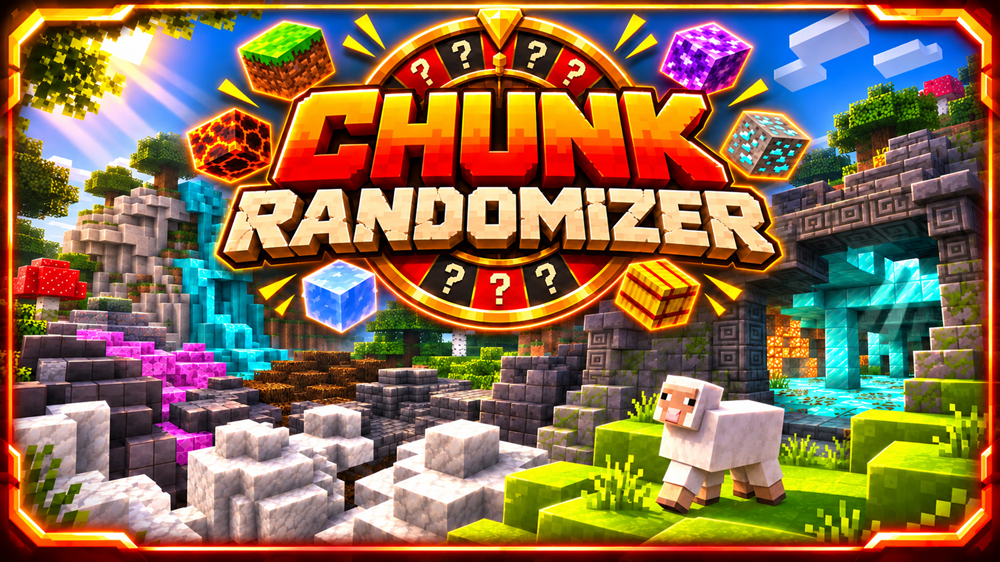

  

  

  

  
  &nbsp;&nbsp;&nbsp;
  

 

  On January 11, 2026, BastiGHG played a Minecraft challenge
  combining random blocks and random monsters in each chunk.

  I really enjoyed this unique challenge and wanted to bring
  the experience into my own fan project.

  This became the fourth challenge game developed for
  <strong>BastiGHG Challenges – Fan Project</strong>.

  <a href="https://www.youtube.com/watch?v=iaAHQPM1AOk">
    Watch BastiGHG's original challenge on YouTube
  </a>

 

# ChunkRandomizer
ChunkRandomizer is a Minecraft challenge game integrated into BastiGHG Challenges – Fan Project.

Every new chunk becomes a surprise.

When players enter a new chunk, its existing blocks are transformed into a randomly selected block type.

At the same time, a challenge mob appears and the WorldBorder prevents players from leaving the current chunk.

Defeat the mob to unlock the border and continue exploring!

Every chunk brings new resources, unexpected situations and challenges.
This game is part of an unofficial fan project inspired by BastiGHG and is not affiliated with him.

## Features
- Random block transformation for newly explored chunks
- One randomly selected block type per chunk
- Original terrain and cave structures are preserved
- Bedrock remains unchanged
- Chunk-based WorldBorder system
- Challenge mob spawning
- Defeat the mob to unlock the WorldBorder
- Multiplayer support
- Overworld, Nether and End world management
- Persistent game progress
- Completed chunk tracking
- Saved game state and challenge timer
- Automatic game data saving
- Separate world and player data
- Integrated into the central challenge lobby
- Central world settings
- Reset management system
##  Commands
###  Main Commands
- /chunkrandomizer
- /chunkrandomizer info
- /chunkrandomizer start
- /chunkrandomizer gamesettings
###  Reset Commands
- Reset options are available through the central reset management system.
##  Gameplay Overview
1. Enter the ChunkRandomizer world.
2. Start the challenge.
3. All participating players are moved to the starting chunk.
4. The WorldBorder restricts movement to the current chunk.
5. The chunk's existing blocks are transformed into a random block type.
6. A challenge mob appears inside the chunk.
7. Defeat the mob to unlock the WorldBorder.
8. Explore another chunk and discover its random block type.
9. Repeat the process, collect resources and survive the challenge.
   How Chunk Transformation Works
   Each newly explored chunk receives a randomly selected block type.

Existing solid blocks are replaced while the original terrain structure is preserved.

This means that mountains, underground caves and other terrain formations remain recognizable, but their blocks change.

Some blocks are excluded from the random selection or transformation to maintain compatibility and gameplay stability.

The result is a unique Minecraft world where every newly explored chunk can offer completely different resources.
WorldBorder & Challenge Mobs
The WorldBorder controls progression through the challenge.

When a new chunk is entered, a challenge mob must be defeated before players can continue exploring.

Once the required mob has been defeated, the border restriction is removed and the next chunk can be explored.

This combines random world generation with combat and exploration.
Game Progress
ChunkRandomizer saves important challenge data, including:
- Current game state
- Starting chunk
- WorldBorder information
- Previously completed chunks
- Challenge mob progress
- Challenge timer
  Saved progress allows the challenge to continue after a server restart.
  Notes
- ChunkRandomizer is integrated into the central lobby system of BastiGHG Challenges.
- ChunkRandomizer is the fourth challenge game in the project.
- The game is inspired by BastiGHG's random block and random monster chunk challenge.
- Game progress can be saved and resumed.
- Reset options are managed through the central reset system.
- ChunkRandomizer is currently in beta development.