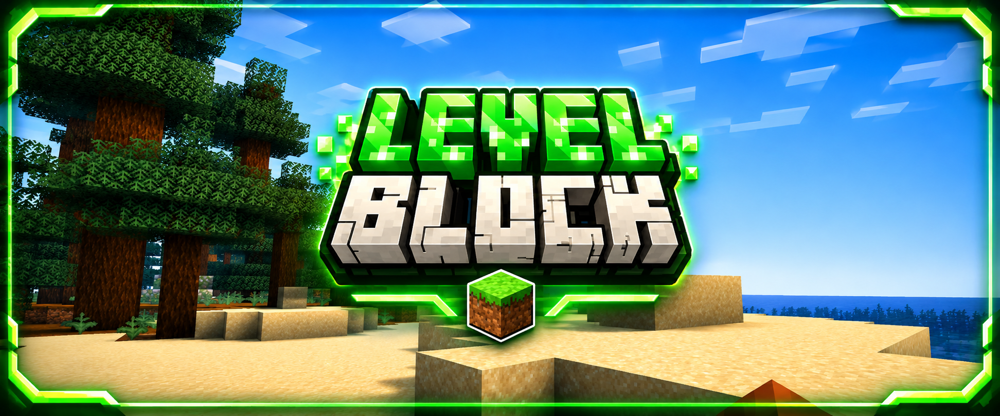

  

  

  

  
  &nbsp;&nbsp;&nbsp;
  

# LevelBlock

LevelBlock ist ein Minecraft-Challenge-Spiel und Bestandteil von **BastiGHG Challenges – Fan Project**.

Zu Beginn steht den Spielern nur ein sehr kleiner Bereich der Welt zur Verfügung.

Durch das Ausgeben von Erfahrungsleveln können zusätzliche Blöcke freigeschaltet werden. Dadurch erweitert sich das zugängliche Gebiet Schritt für Schritt.

**Jedes ausgegebene Erfahrungslevel schaltet einen zusätzlichen Block frei.**

> Dieses Spiel ist Teil eines inoffiziellen Fanprojekts und steht in keiner offiziellen Verbindung zu BastiGHG.

## Funktionen

- Blockweise Erweiterung der spielbaren Welt
- Mehrspielerunterstützung
- Unterstützung für Oberwelt, Nether und End
- Dauerhaft gespeicherter Spielfortschritt
- Getrennte Spieler- und Weltdaten
- Zentrale Welteinstellungen
- Reset-System

## Befehle

### Hauptbefehle

- `/levelblock`
- `/levelblock info`
- `/levelblock start`
- `/levelblock gamesettings`

### Reset-Befehle

- `/levelblock reset`
- `/levelblock reset world`

## Spielablauf

1. Betritt die LevelBlock-Welt.
2. Starte die Challenge mit einem sehr kleinen spielbaren Gebiet.
3. Sammle beim Spielen Erfahrungslevel.
4. Gib deine Erfahrungslevel aus, um zusätzliche Blöcke freizuschalten.
5. Erweitere die zugängliche Welt Block für Block.
6. Erkunde mit zunehmendem Fortschritt die Oberwelt, den Nether und das End.

## Hinweise

- LevelBlock ist in die zentrale Lobby von **BastiGHG Challenges** integriert.
- Jedes ausgegebene Erfahrungslevel schaltet einen zusätzlichen Block frei.
- Der Spielfortschritt kann gespeichert und später fortgesetzt werden.
- Reset-Optionen stehen über das zentrale Reset-System zur Verfügung.
