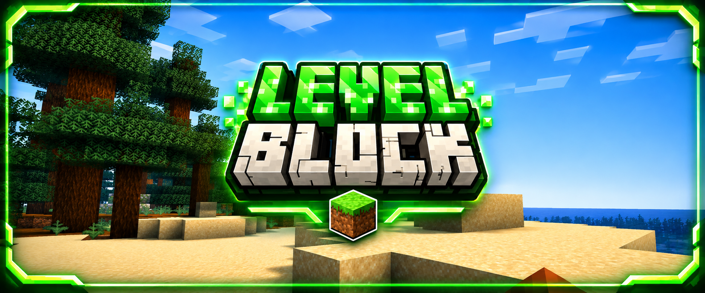

  

  

  

  
  &nbsp;&nbsp;&nbsp;
  

# LevelBlock

LevelBlock is a Minecraft challenge game integrated into **BastiGHG Challenges – Fan Project**.

At the beginning, players have access to only a very small area of the world.

Players can spend their experience levels to unlock additional blocks and gradually expand the accessible world.

**Each experience level spent unlocks one additional block.**

> This game is part of an unofficial fan project and is not affiliated with BastiGHG.

## Features

- Block-by-block world expansion
- Multiplayer support
- Overworld, Nether and End
- Persistent game progress
- Separate player and world data
- Central world settings
- Reset system

## Commands

### Main Commands

- `/levelblock`
- `/levelblock info`
- `/levelblock start`
- `/levelblock gamesettings`

### Reset Commands

- `/levelblock reset`
- `/levelblock reset world`

## Gameplay Overview

1. Enter the LevelBlock world.
2. Start the challenge with a very small playable area.
3. Collect experience levels by playing Minecraft.
4. Spend experience levels to unlock additional blocks.
5. Expand the accessible world one block at a time.
6. Explore the Overworld, Nether and End as your progress increases.

## Notes

- LevelBlock is integrated into the central lobby system of **BastiGHG Challenges**.
- Each experience level spent unlocks one additional block.
- Game progress can be saved and resumed.
- Reset options are available through the central reset system.
