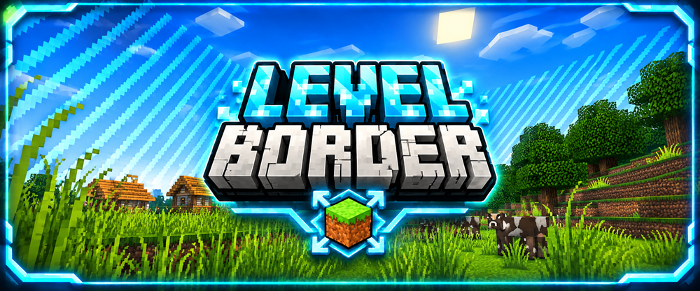

  

  

  

  
  &nbsp;&nbsp;&nbsp;
  

# LevelBorder

LevelBorder ist ein Minecraft-Challenge-Spiel und Bestandteil von **BastiGHG Challenges – Fan Project**.

Die Challenge beginnt mit einer sehr kleinen Weltgrenze (WorldBorder).

Die Weltgrenze wächst abhängig von der Summe der Erfahrungslevel aller Spieler. Je mehr Level die Spieler gemeinsam sammeln, desto größer wird das spielbare Gebiet.

> Dieses Spiel ist Teil eines inoffiziellen Fanprojekts und steht in keiner offiziellen Verbindung zu BastiGHG.

## Funktionen

- Die Weltgrenze wächst abhängig von den gesammelten Spielerleveln
- Gemeinsamer Fortschritt aller Spieler
- Mehrspielerunterstützung
- Unterstützung für Oberwelt, Nether und End
- 1:1-Weltgrenzenverwaltung im Nether
- Integration in die zentrale Challenge-Lobby
- Getrennte Welt- und Spielerdaten
- Dauerhaft gespeicherter Spielfortschritt
- Zentrale Welteinstellungen
- Menü für spielspezifische Einstellungen
- Reset-Abstimmungssystem
- Unterstützung für vollständige Welt-Resets
- Eigenes Mob-Spawning-System für kleine Weltgrenzen

## Befehle

### Hauptbefehle

- `/levelborder`
- `/levelborder info`
- `/levelborder status`
- `/levelborder start`
- `/levelborder stop`
- `/levelborder set <size>`
- `/levelborder center`
- `/levelborder gamesettings`

### Reset-Befehle

- `/levelborder reset`
- `/levelborder reset world`

## Spielablauf

1. Betritt die LevelBorder-Welt.
2. Starte die Challenge mit einer sehr kleinen Weltgrenze.
3. Sammle gemeinsam mit anderen Spielern Erfahrungslevel.
4. Beobachte, wie sich die Weltgrenze mit zunehmenden Leveln erweitert.
5. Erkunde neue Gebiete und sammle weitere Ressourcen.
6. Erweitere deinen Fortschritt in der Oberwelt, im Nether und im End.

## Hinweise

- LevelBorder ist vollständig in die zentrale Lobby von **BastiGHG Challenges** integriert.
- Der Spielfortschritt kann gespeichert und später fortgesetzt werden.
- Reset-Optionen stehen über das zentrale Reset-System zur Verfügung.
- Das eigene Mob-Spawning-System unterstützt das Spielen innerhalb sehr kleiner Weltgrenzen.
