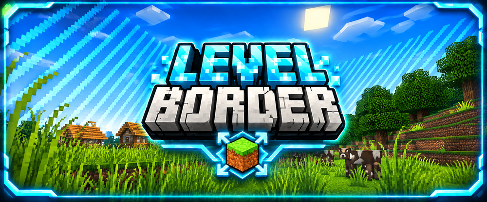

  

  

  

  
  &nbsp;&nbsp;&nbsp;
  

# LevelBorder

LevelBorder is a Minecraft challenge game integrated into **BastiGHG Challenges – Fan Project**.

The challenge starts with a very small WorldBorder. The border grows based on the combined experience levels of all players. The more levels the players collect, the larger the playable area becomes.

> This game is part of an unofficial fan project and is not affiliated with BastiGHG.

## Features

- WorldBorder grows based on the combined player levels
- Shared progression for all players
- Multiplayer support
- Overworld, Nether and End support
- 1:1 Nether border handling
- Integrated into the central challenge lobby
- Separate world and player data
- Persistent game progress
- Central world settings
- Game settings menu
- Reset voting system
- Complete world reset support
- Custom mob spawning support for small border areas

## Commands

### Main Commands

- `/levelborder`
- `/levelborder info`
- `/levelborder status`
- `/levelborder start`
- `/levelborder stop`
- `/levelborder set <size>`
- `/levelborder center`
- `/levelborder gamesettings`

### Reset Commands

- `/levelborder reset`
- `/levelborder reset world`

## Gameplay Overview

1. Enter the LevelBorder world.
2. Start the challenge with a small WorldBorder.
3. Collect experience levels together.
4. Watch the WorldBorder expand as the combined player levels increase.
5. Explore newly accessible areas and gather resources.
6. Progress through the Overworld, Nether and End.

## Notes

- LevelBorder is fully integrated into the central lobby system of **BastiGHG Challenges**.
- Game progress can be saved and resumed.
- Reset options are available through the central reset system.
- Custom mob spawning helps maintain gameplay inside very small borders.
