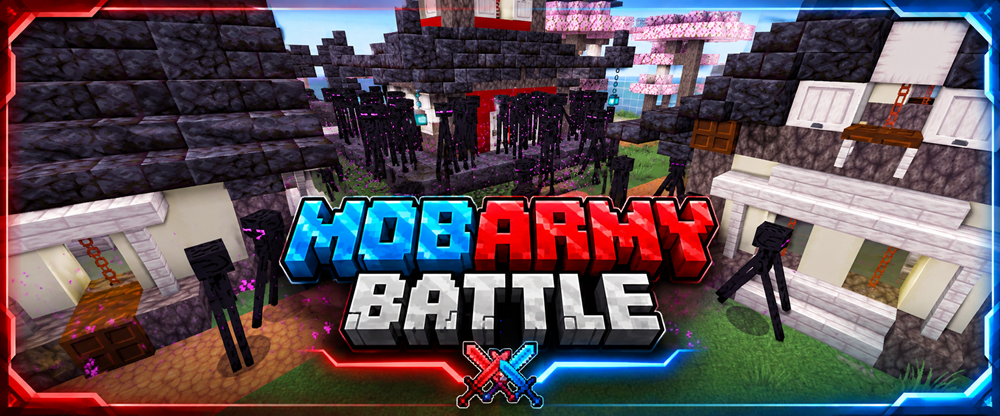

  

  

  

  
  &nbsp;&nbsp;&nbsp;
  

# MobArmyBattle

MobArmyBattle ist ein teambasiertes Minecraft-Challenge-Spiel und Bestandteil von **BastiGHG Challenges – Fan Project**.

Zwei Teams, **Rot** und **Blau**, bereiten sich getrennt voneinander vor, indem sie Ressourcen, Ausrüstung und Mobs sammeln.

Jedes Team stellt Angriffswellen für das gegnerische Team zusammen. Anschließend betreten beide Teams die Arena und kämpfen gegen die vorbereiteten gegnerischen Mobwellen.

> Dieses Spiel ist Teil eines inoffiziellen Fanprojekts und steht in keiner offiziellen Verbindung zu BastiGHG.

## Funktionen

- Zwei Teams: **Rot** und **Blau**
- Separate Teamwelten und Netherwelten
- Vorbereitungsphase zum Sammeln von Ressourcen, Ausrüstung und Mobs
- Drei konfigurierbare Angriffswellen pro Team
- Automatisches Arena-Kampfsystem
- Mehrere Arenen mit Auswahl über ein GUI
- Enthält die Arena **Ancient City**
- Gemeinsame Teamrucksäcke
- Auswahl der Teamausrüstung
- Optionaler Block-Randomizer
- Kisten-Randomizer
- Spiel- und Welleneinstellungen über GUIs
- Monsterkompass für die Arena
- Team- und Arena-Scoreboards
- Mehrspielerunterstützung
- Integration in die zentrale Challenge-Lobby
- Getrennte Welt-, Spieler- und Spieldaten
- Dauerhaft gespeicherter Spielfortschritt
- Zentrale Welteinstellungen
- Reset-Abstimmungssystem
- Unterstützung für Arena-, Teamwelt- und vollständige Welt-Resets

## Befehle

### Hauptbefehle

- `/mobarmy`
- `/mobarmy info`
- `/mobarmy resume`
- `/mobarmy gamesettings`
- `/mobarmy reset`
- `/mobarmy reset world`
- `/mobarmy reset arena`
- `/mobarmy reset teamwelt`

### Teambefehle

- `/team join rot`
- `/team join blau`
- `/team leave`

### Weitere Befehle

- `/mobstatus`
- `/arenasummary`

## Spielablauf

1. Tritt dem Team **Rot** oder **Blau** bei.
2. Sammle Ressourcen und bereite dein Team auf den Kampf vor.
3. Stelle Mobwellen für das gegnerische Team zusammen.
4. Betritt die ausgewählte Arena.
5. Bekämpfe die gegnerischen Mobwellen.
6. Überlebe möglichst lange und besiege mehr Wellen als das gegnerische Team.

## Arenen

- **Japanisches Dorf**
- **Ancient City**

Weitere Arenen können in zukünftigen Versionen hinzugefügt werden.

## Hinweise

- MobArmyBattle ist vollständig in die zentrale Lobby von **BastiGHG Challenges** integriert.
- Der Spielfortschritt kann gespeichert und später fortgesetzt werden.
- Reset-Optionen stehen über das zentrale Reset-System zur Verfügung.
