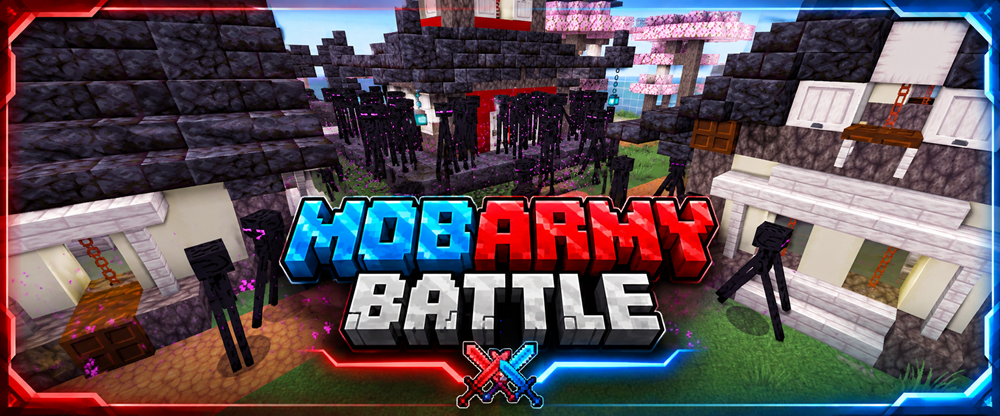

  

  

  

  
  &nbsp;&nbsp;&nbsp;
  

# MobArmyBattle

MobArmyBattle is a team-based Minecraft challenge game integrated into **BastiGHG Challenges – Fan Project**.

Two teams, **Red** and **Blue**, prepare separately by collecting resources, equipment and mobs.  
Each team creates attack waves for the opposing team before both teams enter the arena and fight through the enemy waves.

> This game is part of an unofficial fan project and is not affiliated with BastiGHG.

## Features

- Two teams: **Red** and **Blue**
- Separate team worlds and Nether worlds
- Preparation phase for collecting resources, equipment and mobs
- Three configurable attack waves per team
- Automatic arena battle system
- Multiple arenas with GUI-based arena selection
- Includes the **Ancient City** arena
- Shared team backpacks
- Team equipment selection
- Optional block randomizer
- Chest randomizer
- GUI-based game and wave settings
- Arena monster compass
- Team and arena scoreboards
- Multiplayer support
- Integrated into the central challenge lobby
- Separate world, player and game data
- Persistent game progress
- Central world settings
- Reset voting system
- Arena, team-world and complete world reset support

## Commands

### Main Commands
- `/mobarmy`
- `/mobarmy info`
- `/mobarmy resume`
- `/mobarmy gamesettings`
- `/mobarmy reset`
- `/mobarmy reset world`
- `/mobarmy reset arena`
- `/mobarmy reset teamwelt`

### Team Commands
- `/team join rot`
- `/team join blau`
- `/team leave`

### Additional Commands
- `/mobstatus`
- `/arenasummary`

## Gameplay Overview

1. Join **Red** or **Blue**
2. Gather resources and prepare your team
3. Build mob attack waves for the enemy team
4. Enter the selected arena
5. Fight through the enemy waves
6. Defeat more waves and survive longer than the opposing team

## Arenas

- **Japanese Village**
- **Ancient City**

Additional arenas may be added in future versions.

## Notes

- MobArmyBattle is fully integrated into the central lobby system of **BastiGHG Challenges**
- Game progress can be saved and resumed
- Reset options are available through the central reset system